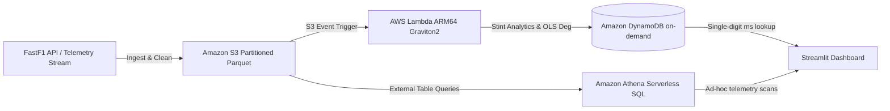

# 🏛️ Architecture & System Design Document

## System Flow
The F1 Telemetry & Strategy Pipeline is an event-driven, serverless data pipeline designed for microsecond telemetry ingestion, partitioned Parquet lakehouse storage, and fast analytical querying.

## Free-Tier Architectural Considerations
- **S3 Snappy Compression**: Parquet storage reduces race telemetry footprint from ~15 MB uncompressed CSV to ~20 KB snappy Parquet per race.
- **ARM64 Graviton2**: Provides 20% lower cost and higher compute performance per millisecond than traditional x86 architecture.
- **On-Demand DynamoDB**: Zero idle charges; 25 free Read/Write capacity units easily accommodate typical 350-item race write batches.
